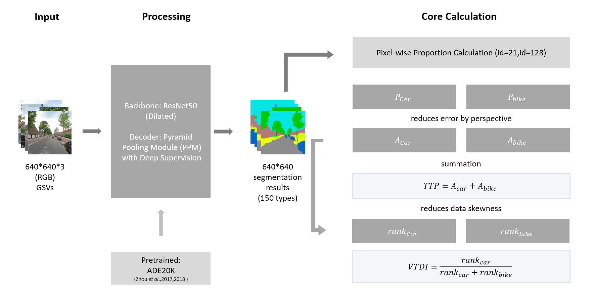
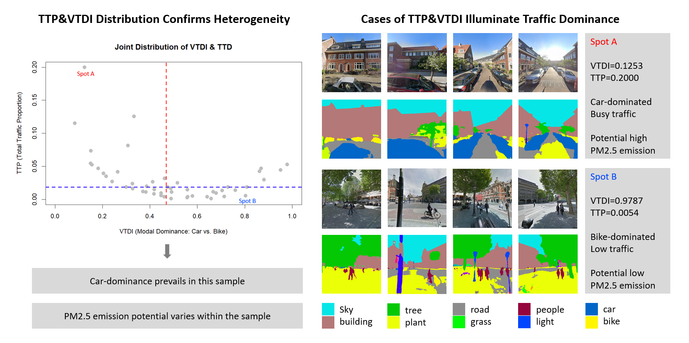

# StreetSignals

**Reading Urban Traffic Patterns from Street-View Imagery**

  2025
  Methodological Pilot Study
  Street-Level Imagery
  Semantic Segmentation
  Environmental Exposure
  GeoAI

---

## Overview

How much can street-view imagery tell us about traffic-related air pollution when direct environmental measurements are unavailable?
  
This exploratory project investigates how street-view imagery can be used to construct interpretable indicators of urban traffic characteristics relevant to air pollution research. Given a dataset of 200 street-view images and an open-ended task to investigate their relevance to air pollution, I designed and implemented an exploratory computer vision workflow to quantify visible traffic characteristics.
  
Rather than attempting to predict PM2.5 concentrations directly, the study examined whether image-derived indicators could describe differences in traffic presence and modal dominance across urban streets.

## Data and Methodology

The dataset contained 200 street-view images organized into 50 groups of four directional views. Because the images provided incomplete and discontinuous visual coverage, reconstructing street geometry or calculating orientation-dependent indicators was not reliable.
  
To work within these constraints, I applied a pretrained semantic segmentation model based on a dilated ResNet-50 backbone and pyramid pooling architecture, using ADE20K semantic categories to identify cars and bicycles.
  
I then developed two complementary indicators:
 

### Total Traffic Portion (TTP)
The combined average pixel proportions of cars and bicycles across four directional images, representing visible traffic presence.
 

### Visual Traffic Dominance Index (VTDI)
A rank-based indicator comparing car and bicycle pixel proportions, representing their relative visual dominance.
 
Together, these indicators provide a simplified description of the visible traffic environment without requiring continuous panoramic coverage or reconstructed street geometry.

<figure style="max-width: 900px; margin: 2rem auto;">
  
  <figcaption style="margin-top: 0.5rem; color: #666; font-size: 0.9rem;">
    Figure 1. Workflow for extracting visual traffic indicators from four-directional street-view imagery.
  </figcaption>
</figure>

## Exploratory Findings

The resulting indicators revealed variation in visible traffic characteristics across the 50 sampled locations.
 
For example, one location exhibited relatively high traffic presence and strong car dominance (TTP = 0.2000; VTDI = 0.1253), while another showed very low traffic presence and stronger bicycle dominance (TTP = 0.0054; VTDI = 0.9787).
 
These contrasting cases demonstrate how semantic segmentation can distinguish different street-level traffic environments. However, the indicators describe visual characteristics rather than measured emissions or pollution exposure.
 

<figure style="max-width: 900px; margin: 2rem auto;">
  
  <figcaption style="margin-top: 0.5rem; color: #666; font-size: 0.9rem;">
    Figure 2. Distribution of visual traffic indicators and contrasting street-view cases.
  </figcaption>
</figure>

## Limitations and Research Implications

Several limitations emerged from this exercise. Static street-view imagery cannot reliably distinguish moving vehicles from parked ones, while pixel proportions are sensitive to camera perspective and object distance. Rank-based indicators also sacrifice information about absolute differences and depend on the sampled dataset.
  
Most importantly, no direct validation against measured PM2.5 concentrations was conducted. The proposed indicators should therefore be treated as exploratory traffic-related visual proxies, not established measures of air pollution exposure.
  
The exercise highlighted a broader methodological challenge in environmental exposure research: extracting measurable features from imagery is not equivalent to establishing their environmental validity. Connecting such features to pollution monitoring, mobility patterns, and exposure pathways would be necessary before using them in epidemiological applications.

